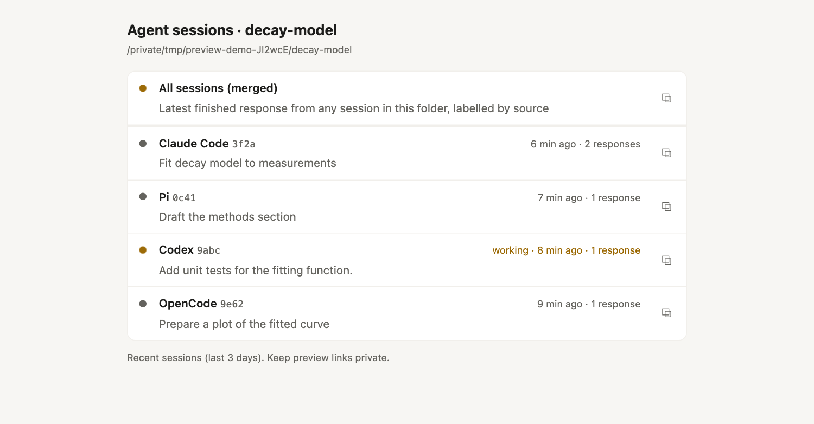
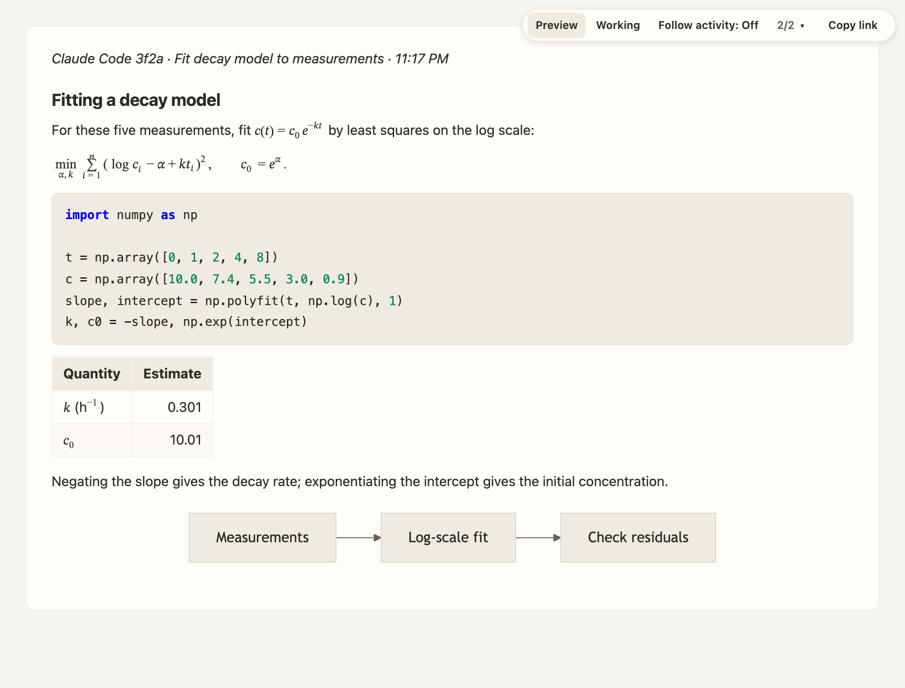
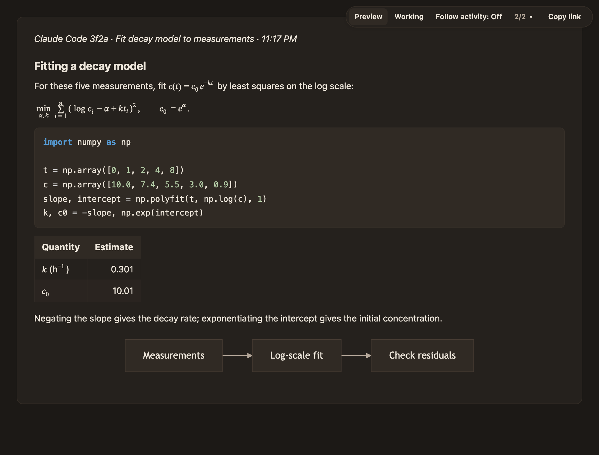
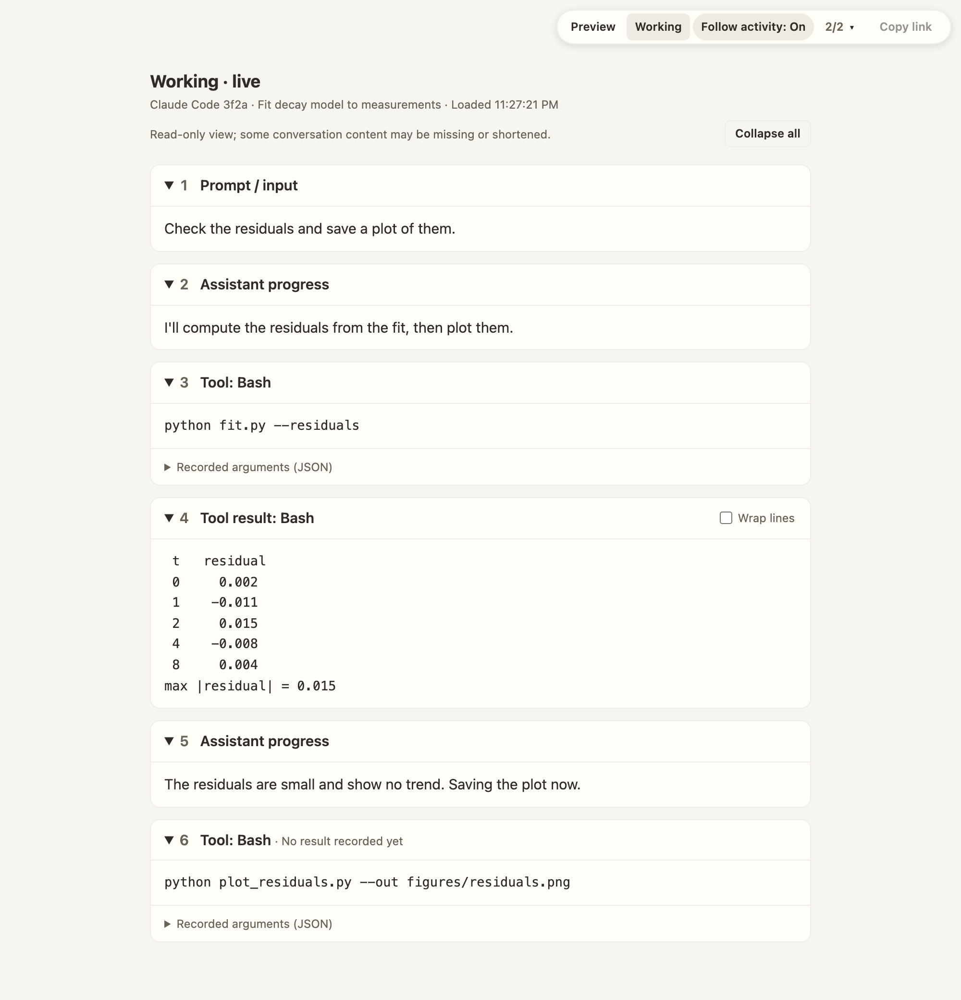
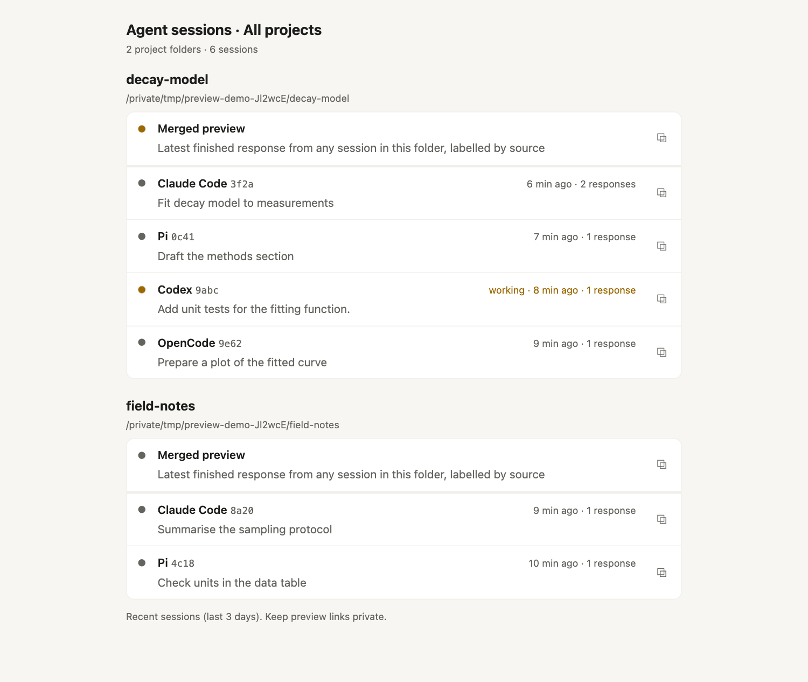
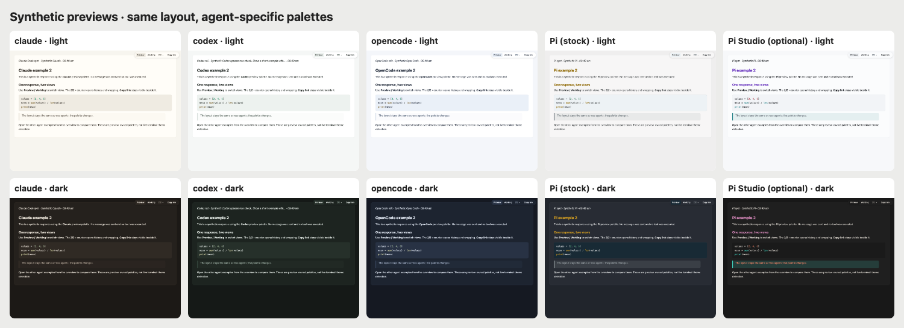

# agent-markdown-preview

Preview coding-agent responses in the browser while you work with [Claude Code](https://docs.claude.com/en/docs/claude-code), [Codex](https://github.com/openai/codex), [Pi](https://pi.dev) or [OpenCode](https://opencode.ai). Each session gets a tab that shows its responses rendered with math, syntax highlighting and Mermaid diagrams, and can follow each turn live, showing prompts, tool calls and results as the agent records them. It reads the session history each agent already writes, so the agents need no setup. It also previews local Markdown, LaTeX, code and diff files.

## Screenshots

Screenshots use synthetic sessions.

**Session index for a project:**



**A response preview, following the system light/dark setting:**

| Light | Dark |
|:--:|:--:|
|  |  |

## Install

```bash
npm install -g agent-markdown-preview
```

Or run it without installing, with `npx agent-markdown-preview`.

You need Node.js 22 or later (22.13+ to read OpenCode's database) and [Pandoc](https://pandoc.org/installing.html) (`brew install pandoc` on macOS; set `PANDOC_PATH` if it is not on your `PATH`). Mermaid diagrams, the MathJax fallback for some equations and PDF figures load pinned modules from jsDelivr or unpkg the first time a page needs them, so those features need network access. It is developed and tested on macOS, should also work on Linux, and is untested on Windows.

## Quick start

In the project directory where you are working with an agent, run:

```bash
agent-markdown-preview --live
```

This opens an index of the project's recent agent sessions. Open a session to get a tab that shows each response when the agent finishes its turn, with earlier responses a click away. **Working**, beside each response, shows the prompts, tool calls and results that led to it. Turn on **Follow activity** in the toolbar (or press Ctrl+Alt+A) to watch each turn in Working as it runs; when the turn finishes, the page returns to the response. With Follow activity off, the tab updates after each turn.



Working shows recorded prompts and tool output to anyone with the tab's link. For responses only, run `agent-markdown-preview` without `--live`.

## Usage

| Command | Description |
|---------|-------------|
| `agent-markdown-preview --live` | Session index with Working and [Live](#live-and-working) |
| `agent-markdown-preview --working` | The same without Live |
| `agent-markdown-preview` | Session index, responses only |
| `agent-markdown-preview -a --live` | Sessions from every project folder |
| `agent-markdown-preview --merged` | One preview of the latest response from any session here |
| `agent-markdown-preview --session <path\|ses_id>` | Preview a single session log or OpenCode session |
| `agent-markdown-preview <file>` | Preview a Markdown, LaTeX, code or diff file and follow its changes |

| Option | Description |
|--------|-------------|
| `--agent claude,codex,pi,opencode` | Agents to follow (default: all) |
| `--cwd <dir>` | Project directory whose sessions to follow (default: current directory) |
| `-a`, `--all`, `--all-projects` | Follow recent sessions from every folder |
| `--opencode-db <path>` | OpenCode database to read instead of the default |
| `--history <n>` | Earlier responses each preview starts with (default 10, maximum 20; 0 shows only the latest) |
| `--theme <name\|file>` | `agent` (default), `neutral`, `claude`, `codex`, `opencode`, `pi`, `pi-studio`, `auto`, a `-light`/`-dark` variant, or a Pi theme `.json` file |
| `--agent-theme <agent=theme>` | Palette for one agent, e.g. `pi=pi-studio`; repeatable |
| `--appearance <mode>` | `system` (default), `light` or `dark` |
| `--font-size <px>` | Base font size |
| `--open` / `--no-open` | Always / never open a browser tab |

### Live and Working

Working shows a response's recorded prompts, progress, any exposed reasoning, and its tool calls and results. Prompts start expanded and activity starts folded. Commands, file reads and edits have readable views, with the recorded JSON available, and recorded images can be enlarged. Code sent to a shared REPL (pi-repl, agent-repl or Pi Studio) shows its runtime and code, and its result shows just the output, headed with the call it belongs to. Claude's questions show their options and the answers given. **Ctrl+Alt+P** and **Ctrl+Alt+W** (Control+Option on macOS) switch between Preview and Working. **Ctrl+Alt+L** goes to the latest response in Preview from any view, including an earlier Working page. Working is available in session previews, not file previews.

With `--live` and **Follow activity** on, the page moves to Working when a turn starts and back to Preview when it ends. If you have scrolled up or moved to another page, it leaves you there. Updates arrive as the agent records them, not token by token, so a tool call shows "No result recorded yet" until its result is recorded. For OpenCode (v2 sessions), a text block appears once OpenCode has recorded it whole, and a tool's output when the tool finishes. A Codex task that ends without a final answer, such as a compaction, returns to the latest Preview. A reverted Codex thread continues in a new session log, which the index lists separately. Anything Live leaves out, such as cards beyond its display limits, is listed in its status line.

**Privacy:** prompts, tool output and recorded images can contain secrets, and nothing is redacted. Share these links only with people you trust. Working uses its own remembered credentials, so links you shared from an ordinary preview don't gain this access. Stopping the `--live` or `--working` process revokes it.

Some content may be shortened or left out; [details](docs/details.md#working) lists what Working reads and its limits.

### Sessions and previews

The index lists sessions active in the last three days, up to eight per agent, with each session's title (or first prompt) and when it was last active; **working** marks a turn in progress. New sessions appear by themselves, including the new log an agent starts after `/clear`.

A preview shows the final response of each turn: the text the agent writes after its last tool call. It starts with the session's last 10 responses and keeps up to 20. Step through them with **Previous**, **Next** and **Latest** in the **current/total ▾** counter menu, or with **Option/Alt+Left/Right** (add **Shift** for the oldest or latest). Press **?** for a list of keyboard shortcuts, or choose **Keyboard shortcuts** in the counter menu. On an older response the page stays put and marks **Latest (new)** when something arrives. **All sessions (merged)** shows the latest response from any session in the directory. A file preview adds a version each time the file changes and keeps your reading position.

`--all-projects` (`-a` or `--all`) groups sessions by folder, each with its own merged preview, and follows up to 64 sessions in total. It cannot be combined with `--cwd`, `--session`, a file argument or `--merged`.



### Links to local files

Links to local files open in the same tab, and Back returns you to where you were. On a rendered file, **Option/Alt+Left** also goes back a page, and **← Return to preview** goes straight to the response you opened it from. Relative links in a response resolve against the project directory, and links inside a file against the file's directory. Markdown, LaTeX, text and code open as rendered snapshots (refresh to reread them). Images, PDFs and HTML pages open in the browser, with HTML run in a sandbox. Other files and folders open a page with buttons to show them in their folder, open them in their default app, or copy the path. Each link also has **Copy local path** and **⋯ File actions** beside it.

These actions run on the machine hosting the preview, and opening a file in its default app can run it. Anyone with a preview's link can use them, so share the link only with people you trust.

### Restarts

Previews keep their addresses when the command restarts, and previews open in the last day start again, so open tabs reconnect and rebuild their history. A new address opens a browser tab; a remembered one doesn't, so use `--open` if you have closed the old tab. Addresses are stored in `~/.agent-markdown-preview/servers.json`, or in `$AGENT_MARKDOWN_PREVIEW_HOME`.

### Themes

By default each response uses its agent's palette and follows the system light/dark setting; the index and file previews use a neutral palette. `--theme` sets one palette for everything, `--agent-theme pi=pi-studio` changes one agent's, and `--appearance` fixes light or dark:

```bash
agent-markdown-preview -a --agent-theme pi=pi-studio
agent-markdown-preview --theme neutral --appearance dark
```



A Pi theme `.json` file gives a single fixed theme. Inside Pi, pi-markdown-preview uses Pi's selected theme directly. [Details](docs/details.md#themes) covers the stock Pi palettes and the other theme rules.

### How responses are found

Claude Code, Codex and Pi write JSONL logs; OpenCode uses SQLite. agent-markdown-preview reads them without changing them.

| Agent | Session logs | Final response of a turn |
|---|---|---|
| Claude Code | `~/.claude/projects/<directory>/*.jsonl` (respects `CLAUDE_CONFIG_DIR`) | the assistant message that ends the turn (`stop_reason: end_turn`), with its text blocks joined |
| Codex | `~/.codex/sessions/YYYY/MM/DD/rollout-*.jsonl` (respects `CODEX_HOME`), matched by the working directory recorded in each file | `task_complete` event, `last_agent_message` |
| Pi | `~/.pi/agent/sessions/--<directory>--/*.jsonl` | assistant message with `stopReason: "stop"` |
| OpenCode v1 | `~/.local/share/opencode/opencode.db` (respects `XDG_DATA_HOME`) | completed assistant message with a terminal finish reason, text from its separate parts |
| OpenCode v2 | Same database; `session_v2` / `session_message` | last completed text answer before the turn's explicit `idle` marker; ordered by message sequence |

Subagent sessions are left out, and Gemini CLI isn't supported yet. These formats are internal to each agent and can change between releases. `--agent opencode` covers both OpenCode versions, and `--session` also accepts an OpenCode `ses_…` ID. Node 22 may warn that its SQLite module is experimental. [Details](docs/details.md#opencode) covers the OpenCode reader.

### Security

The index and every preview listen only on `127.0.0.1`, each with its own random token. Anyone with a preview's link can read it and use its file actions, and the index link lists your sessions (across every folder, for `-a`), so keep these links private. **Copy link** in the toolbar gives a fresh link for another browser. The remembered-addresses file holds the tokens and is readable only by you. [Details](docs/details.md#security) describes what a preview serves.

## Relationship to pi-markdown-preview

agent-markdown-preview uses the browser renderer and watch page from [pi-markdown-preview](https://github.com/omaclaren/pi-markdown-preview), extracted so they run without Pi. Inside Pi, use pi-markdown-preview itself: it also provides terminal image previews, PDF export and colours from your Pi theme.

## Development

```bash
npm install
npm test            # builds, then runs all tests
npm run typecheck
```

The source is TypeScript in `src/`, compiled to `dist/`. Setting `PUPPETEER_EXECUTABLE_PATH` to a Chromium build, such as `chrome-headless-shell`, also runs a real-browser test of light/dark switching.

`src/render.ts` is generated from pi-markdown-preview and should not be edited by hand, and `src/client` and `src/shared` are copied from it unchanged. With a pi-markdown-preview checkout beside this one:

```bash
npm run extract     # regenerate src/render.ts from ../pi-markdown-preview
cp ../pi-markdown-preview/client/* src/client/ && cp ../pi-markdown-preview/shared/*.{js,lua} src/shared/
npm test
```

`scripts/extract-render-core.cjs` copies the top-level declarations the renderer depends on, verbatim and in order, replacing only Pi's `Theme` type with a structural equivalent. `test/equivalence.test.mjs` checks that the rendered HTML is byte-identical to pi-markdown-preview's. It uses `../pi-markdown-preview`, or the path in `AMP_REFERENCE`, and is skipped when neither is available. `src/themes` holds Pi Studio's theme files and the pinned stock Pi colours, with provenance and licensing.

## License

MIT
